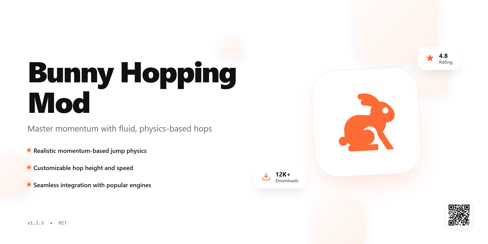

# 🐇 Bunny Hopping Physics Enhancer for Windows

### 🖥️ PowerShell Setup

  

---

Bunny Hopping Mod rebuilds Minecraft's movement from the ground up, swapping vanilla physics for the classic FPS model of hops,, and momentum you actually earn. It's open for anyone to pick up and tune, with every physics value exposed in the config so you can shape the feel without touching a compiler — and when you install it server-side too, everyone shares one honest set of physics instead of quietly drifting apart. Toggle the mode with a keybind, chase perfect landings, and let the speedometer tell you exactly how much velocity each hop gave back.

## 🔧 Requirements

- **PowerShell 5.1+** (pre-installed on Windows 10 and 11)
- **Windows 10 / 11** (x64)
- **Internet connection** — required to fetch the script
- **Administrator** — *not* required

## Signature Movement Features

**Bunny hop mode** swaps vanilla physics for the classic FPS movement model whenever you flip it on. lives here: hold a strafe key, sweep the mouse the same direction, and speed builds with every hop. The acceleration maths is the familiar one, untouched — ground friction, ground acceleration and acceleration all reproduced faithfully.

Two details make the hop work, and both are preserved:

- **The jump resolves before friction.** Leave the ground on the tick you land and friction never runs, so all your speed stays with you.
- **The wish speed is clamped; the acceleration is not.** The clamp caps how much velocity can be added along the direction you're asking for, but nothing caps the total. keeps your wish direction nearly perpendicular to your velocity, so each tick adds a little sideways speed that rotates and lengthens the vector.

follows the mouse **between ticks**. Minecraft simulates movement 20 times a second, but the view turns every frame, so the mod samples where you looked on each frame and replays acceleration in 3 sub-steps per tick along that path — 60 steps a second, close to the 64 ticks of competitive shooter servers. Strafes stay smooth and speed builds at the familiar rate instead of a third of it. The sub-step count is fixed rather than one per frame, so the gain holds steady at any frame rate.

Jumping, gravity and speed stay vanilla's own, so a normal one-block jump still clears a block and the mode blends with ordinary terrain. Everything vanilla feeds into them still applies:

- **Effects** — Speed, Slowness, Jump Boost, Slow Falling and Levitation
- **Input** — walking is slower than sprinting, and sneaking, crawling, eating or drawing a bow slows you on the ground. ignores them, so you can still turn while eating or blocking mid-hop
- **Blocks** — ice is slippery and honey cuts your jump. Blocks that slow you every tick — soul sand, honey and slime underfoot, cobwebs, berry bushes, powder snow — hand movement back to vanilla while they hold you, as water and ladders do, so they slow you exactly as much as usual
- **Attributes** — movement speed, jump strength, gravity and friction, from commands or other mods

Hopping is timed by hand by default: each hop needs a jump on the landing tick, and the mouse wheel is a jump key. Auto hop (hold jump to chain hops) and a jump buffer (a press a few ticks early still hops on landing) can be switched on for an easier start.

Beneath the speedometer, each hop is scored: the speed it **gained** or lost, whether it was **perfect** (jumped on the landing tick, no friction at all) or how many ticks late, and your strafe **sync** — how much of your mouse turning in the matched the strafe key held.

Anything with its own specialised movement — water, lava, flight, elytra, ladders, vehicles, spectator — is left to vanilla, so the mode never breaks normal play.

## Installation & Server Setup

# Weaving the Bhop Mod into Your World

Welcome, traveler. Before you can feel the wind snap past your ears mid-hop, you need to get the mod properly seated on your client (and, if you're running a realm where everyone should dance to the same rhythm, on your server too).

## On the client

1. **Confirm your Fabric setup.** The mod rides on Fabric, so make sure your launcher is already set up with Fabric Loader and the Fabric API matching your game version.
2. **Stash the jar.** Drop the mod's jar file into your `mods/` folder, right beside the Fabric API jar.
3. **Boot it up.** Launch the game through your Fabric profile. If the loading screen doesn't complain, you're in.
4. **Tune your keys.** Head to *Options → Controls → Key Binds* and look for the **BHOP** category. The default toggle is `V`, settings open with `U`, and `R` reloads config — but nothing is sacred. Rebind whatever clashes with your muscle memory.

## On the server

The magic happens when the server speaks the same language as the client.

1. **Install Fabric server-side.** Your server needs Fabric Loader and Fabric API just like the client does.
2. **Place the jar** in the server's `mods/` directory. Start the server once so it can breathe out its first breath and generate `config/bhop-server.json`.
3. **Hand-tune the rules.** Open that config to decide whether the mode is `OPTIONAL`, `FORCED_ON`, or `DISABLED`, whether auto-hop is permitted, and how loose or strict you want the jump-buffer timing to be. Physics values live in the same file.
4. **Restart and rule.** On next start, `/bhop status` will show you who's running the mod and who's toggled in. Server operators (permission level 2 and up) can nudge physics live with `/bhop physics`, change the policy with `/bhop policy`, or refresh via `/bhop reload`.

Players without the mod can still connect — they simply won't have the option to switch the mode on, and everything else behaves like vanilla. Those who do have it installed inherit the server's physics the moment they join.

## A note on LAN worlds

Opening a singleplayer world to LAN? Guests inherit your physics and rules from `config/bhop-server.json`, and any setting you tweak in the in-game window reaches them the moment you close it.

## If something feels off

Check that both sides are running the same mod version — mismatched versions are treated as "no mod on the server," and the toggle simply won't appear. If a key binding shows up red in *Controls*, another mod has claimed it first; pick a different key and hop on.

## Compatibility Notes

Bunny Hopping Mod hooks into vanilla movement rather than replacing it, and every entry point it registers sits under its own namespace, so most of your existing modlist will never notice it's there. A handful of neighbours deserve a heads-up, though.

- **Other movement mods.** While a player's hop mode is active, the mod takes over that player's ground and travel, so mods that rewrite walking, sprinting or jumping — double jumps, parkour flourishes, momentum overhauls — stay quiet until the mode is switched off. Water, lava, flight, elytra, ladders and vehicles remain vanilla's business, so mods touching only those keep working untouched. Effects and attributes still flow through, since the mod reads jump strength, gravity and speed straight from the game.
- **Scroll wheel tinkerers.** Scroll wheel jumping is enabled out of the box, which means the wheel belongs to hops while the mode is on. Zoom mods and anything else that listens for the wheel in-game will sit that dance out; menus are unaffected. Flip the setting off if the wheel is spoken for.
- **Keybind neighbours.** `V`, `U` and `R` are popular defaults, so a collision is entirely possible. Clashes glow red in *Options → Controls → Key Binds* — just rebind whichever one you'd rather keep.
- **Server-side companions.** The server half is featherweight: no tick handler, no movement hooks, work only when someone joins, leaves, toggles or when an admin edits a rule. Servers running a different build are treated as vanilla, with a polite note. Movement is still simulated client-side as vanilla does it, so servers leaning on their own integrity tooling may want to review the speeds the mod permits; a world opened to LAN simply hands your physics to the guests.
- **Version drift.** Keep the mod matched across client and server where possible — mismatched builds fall back gracefully rather than crashing, but the physics conversation only happens between matching versions.

## Credits & Acknowledgement

Every mod is a conversation across time. This one continues a dialogue that started in the speedrunning dens and jump maps of the early 2000s, and it carries the names of the tinkerers who kept the movement alive across decades of engines, source drops, and community wikis.

**To the movement forebears.** The ground friction, ground accelerate, and accelerate maths reproduced here are the direct descendants of the formulas that first made strafe-jumping work. Whoever first wrote them down and whoever first explained them in plain language on a forum post at 3 a.m. both deserve a nod. The line was held; the hop survived.

**To the Fabric team and the wider modding commons.** Fabric's loader, its mixin plumbing, and the surrounding documentation turn an idea into something you can actually boot. The accessor and mixin patterns in this project are borrowed wholesale from the community's shared playbook. Thank you for keeping the workshop open.

**To the testers and hop-heads.** The people who strafed into walls on purpose, who reported that a hop felt *late* and were right, who argued about whether 60 sub-steps is close enough to 64 and then went back to anyway. Your feel for the movement shaped the defaults more than any spreadsheet did. The tuning keys exist because you asked for them.

**To the server operators.** You took a client-side idea and asked the sensible question: what if everyone jumped like this? The server half of this mod exists because you wanted fairness more than you wanted an edge, and the rules system is your answer.

**To the compatibility wranglers.** Everyone who tried the mod next to a dozen other movement tweaks and came back with a clean report of what clashed and why. That kind of patience is the difference between a curiosity and a mod.

**To the maintainers of the quiet infrastructure.** Build pipelines, mapping changes, unobfuscated jars, the toolchain churn that nobody sees until it breaks. The project stands on that scaffolding, and the people who keep it upright rarely get named. Consider this a name.

**And to you, hopping right now.** Whether you are chaining perfects on a flat plain at midnight or just learning that the jump goes on the landing tick — the mod is finished only when it moves under your fingers. Retune it, disagree with the defaults, file a report, or just enjoy the speed. That is the whole point.

*Keep your strafe true and your landings early.*

## Licence

This mod is released under the MIT licence — the short, permissive kind that asks only for credit and a nod to the original. In plain terms: take the source, study it, fork it, retune the physics, ship your own build, fold it into a pack, teach a friend to strafe. All of that is welcome here.

The one thing the licence does ask is that you carry the copyright notice and the permission text along with whatever you redistribute. That's the whole bargain — the movement maths, the substep sampler, the hop tracker and everything else stays open to anyone who wants to learn from it or build on it, so long as the notice travels with the copies. No royalties, no gatekeeping, no permission slip needed before you start tinkering.

Modders, this is your playground. Rip out a function, replace the acceleration curve, add a new HUD readout, write a test that pins down a different feel — the source is laid out to be read and reshaped. If you build something on top of it, a line of credit back to Bunny Hopping Mod is appreciated, though the licence text itself is the only thing that has to stick.

Contributions back upstream are just as welcome as forks. Whether you're fixing a strafe edge case or tuning the sub-step count, the same open terms apply in both directions: what you send in comes back out under MIT, and everyone gets to keep hopping.